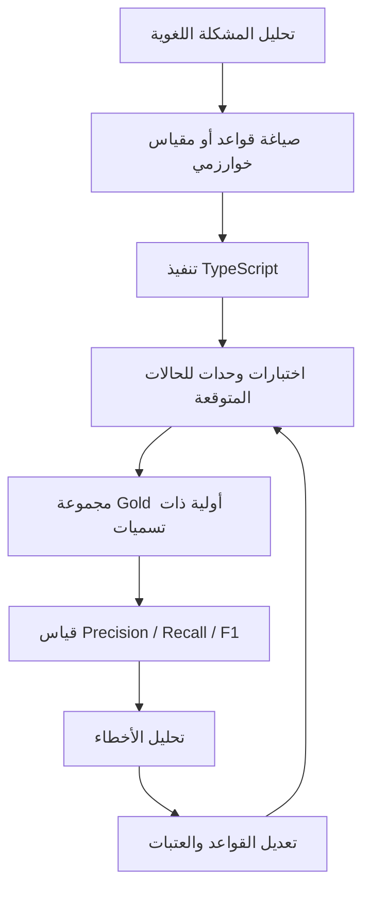
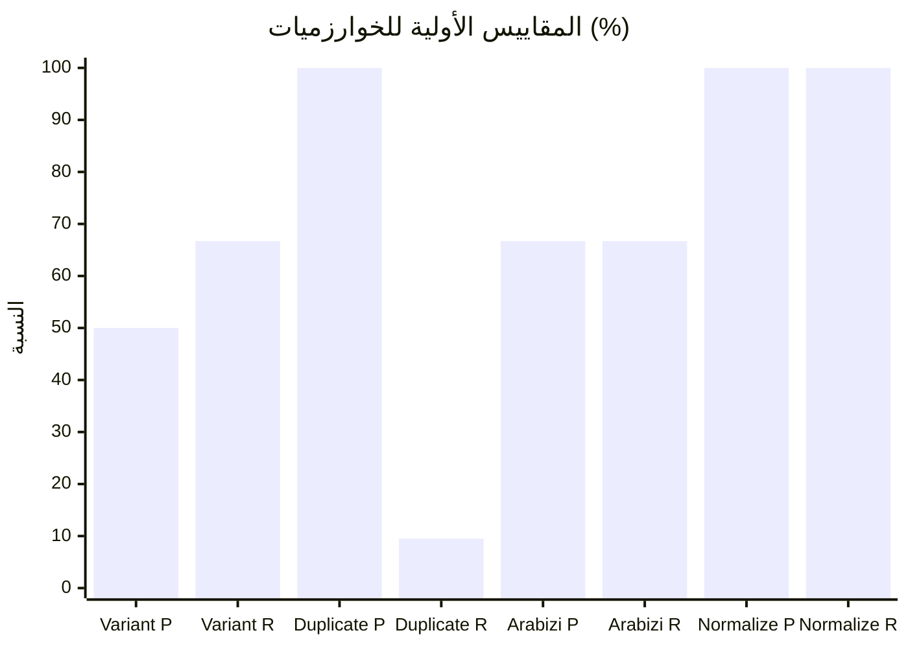
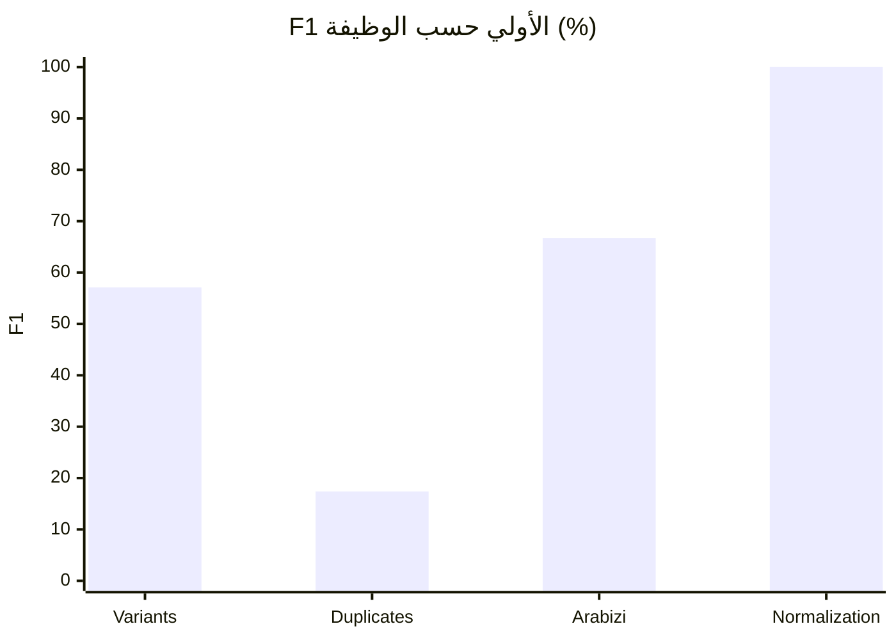
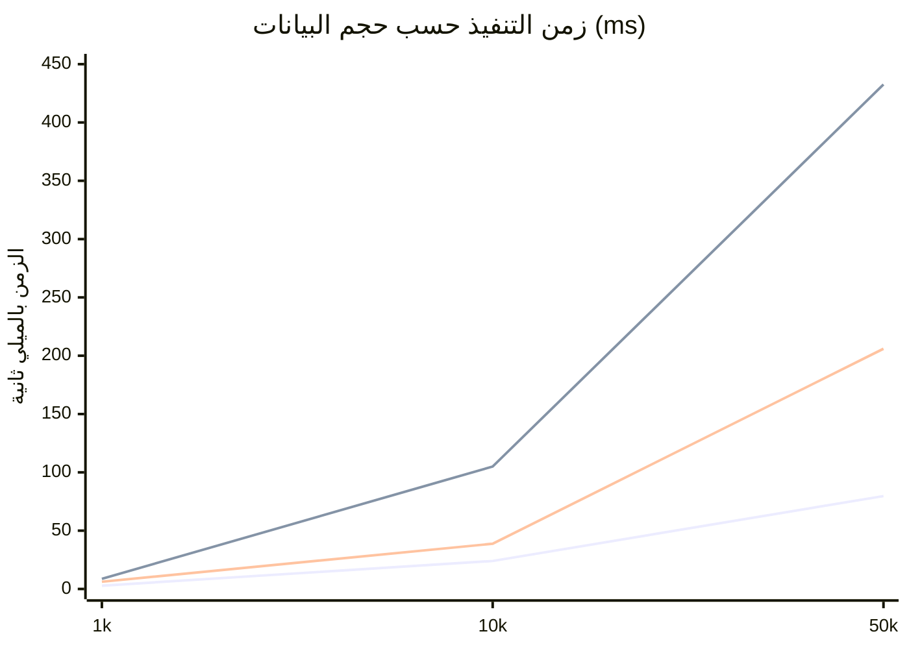

> **تحديث منهجي 2026-11-03:** أُعيد تشغيل مجموعة Benchmark على رأس فرع PR #24 في CI run #15 بعد مزامنة الخوارزميات واختبارات الانحدار مع PR #23. الأرقام أدناه هي قياسات هذا التشغيل على fixtures مؤقتة وبيئة GitHub-hosted runner؛ ليست دليلاً على دقة لغوية ممثلة للهجات المغربية.

# تقرير المحرك الخوارزمي للدارجة المغربية
## الإصدار التمهيدي 0.1.0 — تقرير هندسي ونتائج Benchmark

> **الحالة:** إصدار تمهيدي للبحث والتقييم، وليس إصداراً إنتاجياً.
> **المستودع:** [ArCode-Standard/darija-lexreview](https://github.com/ArCode-Standard/darija-lexreview)
> **نطاق التقرير:** المحرك الخوارزمي المستقل ومجموعة الاختبار الأولية المضافة في PR #24.
> **تاريخ التقرير:** 2026-11-03

---

## 1. الملخص التنفيذي

يقدم هذا التقرير وصفاً للبنية الخوارزمية لمحرك Darija LexReview، ومنهجية تطويره، وطريقة تقييمه، ونتائج اختبارات الدقة والاسترجاع والأداء الأولية.

النتيجة الأساسية: نجح المحرك في اجتياز فحوص التطبيق في CI، وأصبحت لدينا آلية أولية لقياس بعض وظائفه. لكن البيانات الحالية صغيرة ومؤقتة، ولا تكفي لإثبات دقة لغوية ممثلة للهجات المغربية أو السماح باتخاذ قرارات تحريرية آلية.

**قرار الإصدار 0.1.0:** إصدار توثيقي/تجريبي للمراجعة الهندسية فقط. لا يوصى بدمجه بوصفه مرجعاً لغوياً موثوقاً أو استخدام مخرجاته لقبول المفردات أو رفضها أو دمجها تلقائياً.

### أبرز النتائج

- مجموعة أولية من 32 صيغة عربية ولاتينية.
- قياسات أولية لأربع وظائف: تطبيع الكتابة، تحويل Arabizi، اكتشاف المتغيرات، واكتشاف التكرار.
- قياس زمن ثلاث عمليات عند 1,000 و10,000 و50,000 مدخل اصطناعي.
- اكتشاف ضعف الاسترجاع في خوارزمية اكتشاف التكرار على العينة.
- تحديد خطر تعقيد تربيعي في اكتشاف المتغيرات.
- إصلاح التحقق من قيمة Threshold غير الصالحة في اكتشاف المتغيرات.
- نجاح TypeScript والاختبارات والبناء الإنتاجي في فحوص التطبيق؛ اختبار قاعدة البيانات/RLS مستقل عن هذا التغيير ولم يكن قد اكتمل وقت إعداد نتيجة التقرير.

---

## 2. ما هو المحرك؟

المحرك مكتبة TypeScript مستقلة لتحليل النصوص والمفردات المغربية وتوليد إشارات مساعدة للمراجعين. يفصل بين التحليل الخوارزمي وواجهة React وخدمات Supabase.

تشمل وحداته، وفق الكود الحالي:

1. تطبيع النصوص العربية وArabizi ومفاتيح البحث.
2. كشف نوع الكتابة ومعالجة النصوص.
3. تحويل Arabizi إلى اقتراحات كتابة عربية.
4. قياس تشابه السلاسل واكتشاف مرشحي التكرار.
5. اكتشاف مرشحي المتغيرات الإملائية.
6. تنبيهات سطحية لاحتمال تعارض القطبية ضمن سياق موضوعي مشترك.
7. مؤشرات لهجية اعتماداً على معجم يمرره المستدعي ويحدد مصادره.
8. فرضيات صرفية سطحية ومؤشرات جودة لغوية.
9. فحوص سلامة البيانات واكتمال بيانات الأدلة.
10. ترتيب أولويات المراجعة وملخصات التوزيع الجغرافي.
11. تشخيص سياق الاستعمال.
12. تشابه جيب التمام لمتجهات يوفرها المستدعي.

هذه الوظائف ليست كلها نماذج لغوية. كثير منها قواعد تحويل أو مقاييس تشابه أو فحوص بيانات.

## 3. كيف تم تدريب المحرك؟

### 3.1 التوضيح الضروري: لم يتم تدريب نموذج تعلم آلي

المحرك في الإصدار الحالي **ليس نموذجاً لغوياً جرى تدريبه على corpus**، ولا توجد عملية تدريب أو Fine-tuning أو أوزان نموذج تعلم آلي ضمن هذا المحرك.

لم يتم:
- تدريب Transformer أو مصنف عصبي.
- تدريب embeddings من نصوص مغربية.
- استخدام مجموعة بيانات ضخمة لتعلّم قواعد اللهجات.
- تنفيذ Fine-tuning أو تدريب ذاتي.
- الاتصال بخدمة AI خارجية أثناء تشغيل الخوارزميات.

لذلك، التعبير الدقيق هو: **تم تطوير الخوارزميات يدوياً واختبارها على أمثلة مرجعية أولية**، وليس تدريب نموذج ذكاء اصطناعي.

### 3.2 كيف بُنيت الوظائف الحالية؟

| الوظيفة | طريقة البناء الحالية |
|---|---|
| التطبيع | قواعد حتمية لمعالجة بعض اختلافات الحروف والعلامات والمسافات |
| Arabizi | قواعد تحويل ثابتة من الحروف/الأرقام اللاتينية إلى اقتراحات عربية |
| التشابه | مقاييس شكلية مثل Edit Similarity وJaro-Winkler |
| اكتشاف التكرار | مقارنة نص الاستعلام بمجموعة مرشحين وفق عتبة تشابه |
| اكتشاف المتغيرات | مقارنة زوجية بين الصيغ ثم ترتيب المرشحين |
| التحليل الصرفي | قواعد سطحية تنتج فرضيات، وليست تحليلاً صرفياً شاملاً |
| الجغرافيا اللهجية | مطابقة معجم يقدمه المستدعي مع بيانات مصدرية |
| التشابه الدلالي | Cosine similarity على متجهات خارجية يمررها المستدعي؛ لا ينشئ المحرك embeddings |

### 3.3 دورة التطوير والتقييم



هذه دورة هندسة واختبار، وليست دورة تدريب نموذج تعلم آلي.

### 3.4 ما الذي يلزم لتدريب نموذج مستقبلي؟

إذا تقرر لاحقاً إدخال نموذج تعلم آلي، فسيحتاج ذلك إلى مشروع منفصل يتضمن:
- Corpus مغربياً موثق المصدر والحقوق والموافقة.
- تمثيلاً للمناطق واللهجات والسياقات وأنظمة الكتابة.
- تعليمات Annotation واضحة ومراجعين مستقلين.
- تقسيم Train / Validation / Test دون تسرب بين المجموعات.
- اختيار مهمة محددة: تصنيف، ترتيب مرشحين، أو تحويل كتابي.
- مقارنة نموذج متعلم بخط أساس حتمي.
- تقييم الانحياز الجغرافي، والثقة، والحالات خارج التوزيع.
- إبقاء القرار التحريري النهائي بيد الإنسان.

لا توجد ادعاءات بأن هذه الخطوات نُفذت في الإصدار الحالي.

---

## 4. مجموعة الاختبار الأولية

المسار: `benchmarks/dataset.ts`

تتضمن المجموعة 32 صيغة اختبارية مكتوبة بالعربية واللاتينية، مع حقول مثل:
- `id`: معرف الحالة.
- `form`: الصيغة المكتوبة.
- `script`: نظام الكتابة.
- `senseId`: تسمية معنى مؤقتة.
- `regionTags`: وسوم نطاقات التغطية المستهدفة.
- `expectedArabic`: الناتج العربي المتوقع لحالات التحويل.

كما توجد أزواج منفصلة لاختبار التطبيع الإملائي، حتى لا نخلط بين اختلاف الكتابة والترادف.

### حدود البيانات

هذه Fixtures هندسية مؤقتة، وليست corpus ممثلاً للمغرب. الوسوم الجغرافية تحدد التغطية المراد مراجعتها، ولا تعني أن الكلمة حصرية لمنطقة بعينها. كما أن Sense IDs تسميات أولية لم تُحكّم بعد من متحدثين مستقلين.

قبل اعتمادها كمرجع لغوي، يجب:
1. مراجعة الصيغ مع متحدثين أصليين من المناطق المستهدفة.
2. توثيق مصدر كل صيغة وسياقها وحقوق استخدامها.
3. فصل اختلاف الكتابة عن اختلاف النطق والمعنى والتصريف.
4. اعتماد محكمين اثنين على الأقل لكل نطاق لهجي، مع آلية لحسم الخلاف.
5. تجميد نسخة بيانات وإصدارها بمعرف Version.
6. الاحتفاظ بحالات اختبار لا تستخدم أثناء ضبط القواعد.

---

## 5. منهجية القياس

### 5.1 المقاييس

- **Precision:** نسبة النتائج التي اقترحتها الخوارزمية وكانت صحيحة ضمن الحالات المرجعية.
- **Recall:** نسبة الحالات الصحيحة المرجعية التي استطاعت الخوارزمية استرجاعها.
- **F1:** المتوسط التوافقي بين Precision وRecall.

```
Precision = TP / (TP + FP)
Recall    = TP / (TP + FN)
F1        = 2 × Precision × Recall / (Precision + Recall)
```

حيث:
- TP: نتيجة صحيحة.
- FP: نتيجة خاطئة.
- FN: حالة صحيحة لم تكتشفها الخوارزمية.

لا يجوز تفسير Precision أو Recall دون فهم تعريف الحالة الإيجابية في كل اختبار.

### 5.2 نتائج الجودة الأولية

النتائج المسجلة في سجل CI الخاص باختبارات benchmark:

| الوظيفة | TP | FP | FN | Precision | Recall | F1 |
|---|---:|---:|---:|---:|---:|---:|
| اكتشاف المتغيرات | 2 | 2 | 1 | 50.0% | 66.7% | 57.1% |
| اكتشاف التكرار | 4 | 0 | 38 | 100% | 9.5% | 17.4% |
| تحويل Arabizi | 10 | 5 | 5 | 66.7% | 66.7% | 66.7% |
| التطبيع الإملائي | 3 | 0 | 0 | 100% | 100% | 100% |

**تحفظ مهم:** التطبيع اختُبر على ثلاثة أزواج إيجابية وحالتين سلبيتين فقط. النتيجة 100% تصف هذه الحالات الخمس، ولا تعني أن التطبيع صحيح بنسبة 100% على الدارجة المغربية.

### 5.3 مبيان نتائج الجودة



مبيان F1 للمقارنة:



### 5.4 تفسير النتائج

**اكتشاف المتغيرات — F1 = 57.1%**

النتيجة تشير إلى أن ترتيب المرشحين لا يزال يخلط بعض الصيغ المختلفة، كما يفوّت حالة مرجعية. التشابه الكتابي لا يثبت أن الصيغتين تمثلان الكلمة نفسها.

**اكتشاف التكرار — F1 = 17.4%**

Precision مرتفع على هذه العينة، لكن Recall منخفض جداً: اكتشفت الوظيفة 4 حالات من أصل 42 حالة موجبة مرجعية في الاختبار. العتبة أو تعريف المرشح أو خصائص المقارنة قد تكون شديدة التحفظ. لا ينبغي تخفيض العتبة عشوائياً دون قياس FP.

**تحويل Arabizi — F1 = 66.7%**

الأداء متوسط في الأمثلة الحالية. يجب توسيع الأمثلة لتشمل اختلافات كتابة الأرقام والحروف، مثل تمثيل القاف والغين والخاء، والاختلافات الشخصية والإقليمية، والكلمات المختلطة.

**التطبيع — 100% على 5 حالات**

هذه نتيجة Smoke Test ضيقة، وليست مقياس تغطية لغوية. المطلوب آلاف الحالات الإملائية المراجعة، بما فيها الضوابط السلبية.

---

## 6. قياس الأداء عند 1k / 10k / 50k

تم إنشاء مدخلات اصطناعية بأحجام 1,000 و10,000 و50,000 لقياس المسارات الخطية/شبه الخطية التالية:
- تطبيع مفاتيح النصوص.
- بحث تكرار باستعلام واحد مقابل قائمة المرشحين.
- تحويل سلسلة Arabizi ثابتة لكل مدخل.

### 6.1 النتائج المسجلة

الأزمنة بالميلي ثانية على GitHub-hosted runner:

| عدد المدخلات | التطبيع | بحث التكرار باستعلام واحد | تحويل Arabizi |
|---:|---:|---:|---:|
| 1,000 | 2.82 | 8.70 | 6.19 |
| 10,000 | 24.00 | 104.98 | 38.78 |
| 50,000 | 79.65 | 432.59 | 205.98 |



ترتيب السلاسل في الرسم: التطبيع، بحث التكرار، تحويل Arabizi.

### 6.2 قراءة الأداء

- زاد الزمن مع زيادة عدد المدخلات كما هو متوقع في هذه المسارات.
- بحث التكرار عند 50 ألف مدخل بلغ نحو 408 ms في هذا التشغيل.
- هذه قياسات تشغيل واحدة وليست دراسة إحصائية؛ يلزم تكرار التجربة، وحساب الوسيط وP95، وتثبيت بيئة القياس قبل اعتمادها.
- البيانات اصطناعية ولا تمثل طول الكلمات أو توزيع التكرار أو تنوع النصوص الحقيقية.

### 6.3 قيد اكتشاف المتغيرات

تستخدم `discoverVariantCandidates` مقارنة زوجية مباشرة. عدد الأزواج هو:

| حجم المجموعة | عدد المقارنات الزوجية |
|---:|---:|
| 1,000 | 499,500 |
| 10,000 | 49,995,000 |
| 50,000 | 1,249,975,000 |

لم يتم تشغيل المقارنة الكاملة على 10k و50k؛ فقد تم الإبلاغ عن عدد الأزواج بدلاً من اختلاق زمن تنفيذ غير مقاس.

التعقيد الزوجي يجعل التوسع غير عملي قبل إضافة Candidate Blocking أو فهرسة.

---

## 7. الإصلاحات التي أُدخلت

### 7.1 التحقق من Threshold

أضيف تحقق إلى `discoverVariantCandidates` لرفض:
- `NaN`
- القيم اللانهائية
- القيم الأقل من 0 أو الأكبر من 1

ويتم إطلاق `RangeError` بدلاً من قبول قيمة غير صالحة وإنتاج نتائج مضللة.

### 7.2 ضبط تسميات الاختبار

- فصل أزواج التطبيع الإملائي عن أزواج المعنى.
- قصر مرجع اكتشاف المتغيرات على المقارنات التي تتفق في نظام الكتابة والمعنى المرجعي، لتجنب اعتبار الصيغة العربية واللاتينية خطأً في اكتشاف المتغيرات نفسها.
- إضافة تقييم مستقل لاكتشاف التكرار.

### 7.3 ما لم يُصلح بعد

- انخفاض Recall في اكتشاف التكرار.
- التباس المرشحين في اكتشاف المتغيرات.
- أخطاء تحويل Arabizi.
- تعقيد المقارنة الزوجية.
- غياب Gold Dataset للوظائف اللغوية الأخرى.

---

## 8. تغطية الاختبارات وحالة CI

في تشغيل CI رقم 13:
- TypeScript checks: ناجح.
- Unit tests بما فيها benchmark tests: ناجحة، 52 اختباراً.
- Production build: ناجح.
- وظيفة Supabase database/RLS كانت مستقلة وما زالت قيد التشغيل وقت إعداد هذا التقرير.

نجاح الاختبارات يثبت أن الكود اجتاز الحالات البرمجية المحددة، ولا يثبت صحة التفسير اللغوي.

---

## 9. الخوارزميات التي لم تحصل على تقييم دقة

لا توجد أرقام Precision/Recall/F1 موثوقة بعد للوظائف التالية:
- Morphology analysis.
- Contradiction detection.
- Dialect geography.
- Context analysis.
- Linguistic quality.
- Evidence quality.
- Review priority.
- Semantic/vector similarity.

تحتاج كل وظيفة إلى تعريف مستقل لما يعنيه TP وFP وFN، وأمثلة مرجعية يراجعها مختصون. استخدام تسميات تشابه الكلمات لتقييم التناقض أو الصرف، مثلاً، سيكون خطأً منهجياً.

---

## 10. المخاطر والضوابط التحريرية

1. التشابه الشكلي لا يساوي الترادف أو وحدة المعنى.
2. تحويل Arabizi اقتراح، ويجب الاحتفاظ بالنص الأصلي.
3. التطبيع لا يستبدل الصيغة الأصلية المخزنة.
4. غياب كلمة من بيانات منطقة ما لا يعني أنها غير مستعملة فيها.
5. مؤشر اكتمال الأدلة لا يثبت صحة المصدر.
6. تشابه المتجهات لا يثبت المعنى.
7. لا ينبغي لأي نتيجة منفردة أن تقبل أو ترفض أو تدمج أو تنشر مفردة.
8. يجب تسجيل إصدار المحرك والبيانات والعتبات مع كل نتيجة مستقبلية.

---

## 11. خارطة الطريق المقترحة

### المرحلة A — تأسيس Corpus موثّق
- توسيع المفردات والصيغ من مناطق متعددة.
- توثيق المصدر والسياق ونظام الكتابة.
- مراجعة مزدوجة وحسم الخلافات.
- فصل مجموعات التطوير والاختبار.

### المرحلة B — تحسين الخوارزميات
- Candidate Blocking وفهرسة لاكتشاف المتغيرات.
- تحليل أخطاء False Positives وFalse Negatives في التكرار.
- تحسين قواعد Arabizi وقياس كل نمط على حدة.
- اختبار التطبيع على حالات سلبية أكثر.

### المرحلة C — تقييم شامل
- Precision / Recall / F1 لكل وظيفة على حدة.
- Confusion Matrix عند ملاءمتها.
- قياس الوسيط وP95 واستهلاك الذاكرة.
- اختبار 1k و10k و50k بعد تحسين الخوارزميات التربيعية.
- اختبارات انحدار ثابتة لكل إصلاح.

### المرحلة D — قرار الدمج
لا يوصى بالدمج الإنتاجي إلا بعد:
- مراجعة بشرية للبيانات المرجعية.
- تحسن المقاييس وفق عتبات قبول محددة مسبقاً.
- مراجعة أمنية وأدائية.
- توثيق القيود وعدم اليقين.
- إبقاء الموافقة التحريرية النهائية بشرية.

---

## 12. قرار الإصدار 0.1.0

**الحالة: PRE-RELEASE / EXPERIMENTAL**

هذا الإصدار صالح لـ:
- مراجعة البنية البرمجية.
- إعادة تشغيل الاختبارات.
- دراسة نتائج الأداء الأولية.
- توسيع بيانات Gold وتطوير الاختبارات.

ليس صالحاً لـ:
- اتخاذ قرارات لغوية آلية.
- النشر التلقائي للمفردات.
- دمج المرادفات أو التكرارات دون مراجعة.
- الادعاء بأن المحرك تعلم اللهجات المغربية أو تدرب عليها.
- اعتبار أرقام العينة الصغيرة دقة عامة للمحرك.

**الخلاصة:** لدينا الآن محرك خوارزمي حتمي واختبارات أولية قابلة لإعادة التشغيل، وليس نموذجاً مدرباً أو مرجعاً لغوياً نهائياً. الأولوية التالية هي بناء Corpus مغربي موثّق وتحسين الخوارزميات وفق أخطاء مقاسة، قبل ربطها بقرارات المحررين.

---

## المراجع الداخلية

- `algorithms/README.md` — وصف وحدات المحرك وحدوده.
- `algorithms/CONTRACT.md` — العقد والحدود التحريرية.
- `benchmarks/dataset.ts` — بيانات الاختبار الأولية.
- `tests/benchmarks.test.ts` — اختبارات الجودة والأداء.
- `tests/algorithms.test.ts` — اختبارات الوحدات.
- PR #23 — تجميع المحرك الخوارزمي.
- PR #24 — مجموعة الاختبار والتقييم الأولية.
